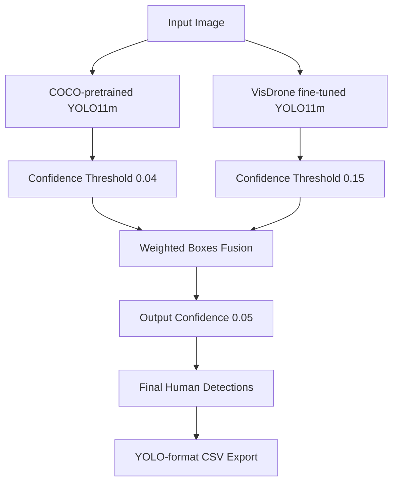

# Scale and Rotation-Robust Aerial Human Detection

**Alex Eagles | Task 3**


An experimental aerial human detection pipeline combining
high-resolution inference, domain-specific fine-tuning,
confidence optimization, and Weighted Boxes Fusion.

**Best Kaggle Public Score: 0.79575**

**Relative improvement over the initial baseline: 44.39%**

## 1. Project Overview

This project investigates human detection under challenging
aerial imaging conditions, including small object sizes,
arbitrary camera orientations, illumination changes,
and different viewing angles.

The objective is to develop a robust object detection pipeline
for a 590-image competition benchmark without an official
training dataset.

Eight experiments were conducted to investigate the impact
of input resolution, confidence thresholds, domain-specific
fine-tuning, rotation-based test-time augmentation,
overlapping tiled inference, and model ensembling.

The final approach combines COCO-pretrained and VisDrone
fine-tuned YOLO11m models using Weighted Boxes Fusion.

The best Kaggle public score increased from 0.55109 to
0.79575, representing a relative improvement of 44.39%.

## 2. Key Challenges

- Small and distant human detection.
- Arbitrary camera rotations.
- Variations in brightness, contrast, and color balance.
- Domain shift between conventional and aerial imagery.
- Balancing false positives and missed detections.

## 3. Datasets

### COCO

COCO-pretrained YOLO11m weights were used to establish the initial detection baseline.

### VisDrone2019-DET

VisDrone was selected as an external dataset for aerial human detection and domain adaptation.

| Split | Images | Purpose |
|---|---:|---|
| Training | 6,471 | Domain-specific fine-tuning |
| Validation | 548 | Local evaluation and optimization |
| Competition test | 590 | Automated inference and submission |

The pedestrian and people categories in VisDrone were merged into a single human class.

Annotations were converted from absolute pixel coordinates to normalized YOLO bounding box coordinates, with bounding box clipping applied during training label preparation.

The competition test images were excluded from model training and manual annotation.


*Example of annotated humans in aerial imagery from the VisDrone validation dataset.*


## 4. Methodology

The project follows an iterative experimental approach:

1. Establish a COCO-pretrained YOLO11m baseline.
2. Analyze bounding box sizes and confidence distributions.
3. Investigate high-resolution inference.
4. Construct an external aerial validation set using VisDrone.
5. Implement a local approximation of the competition metric.
6. Optimize confidence thresholds through systematic searches.
7. Fine-tune YOLO11m on aerial imagery.
8. Investigate custom rotation-based test-time augmentation.
9. Implement overlapping tiled inference.
10. Combine pretrained and fine-tuned models using WBF.
11. Conduct an extended fusion parameter search.
12. Develop and test a standalone inference pipeline.

Model configurations were evaluated on external labeled
validation images before competition submission.

## 5. Custom Evaluation Metric

A custom local evaluator was implemented based on the competition's Hard + Clamped Soft F1 specification.

Predicted bounding boxes are matched to ground-truth annotations through greedy one-to-one matching using Intersection over Union (IoU).

The implemented matching credits are:

| IoU range | Hard credit | Soft credit |
|---|---:|---:|
| IoU below 0.15 | 0 | 0 |
| 0.15 ≤ IoU < 0.30 | 0 | IoU / 0.30 |
| IoU ≥ 0.30 | 1 | 1 |

The final score is calculated as:

**Final Score = 0.5 × Hard F1 + 0.5 × Clamped Soft F1**

This implementation enables local comparison of inference configurations without relying exclusively on the public leaderboard.

## 6. Exploratory Data Analysis

The initial prediction analysis revealed that a large proportion of detected objects occupied less than 0.5% of the image area.


*Distribution of normalized bounding box areas in the initial baseline predictions.*


*Confidence score distribution of the pretrained baseline.*

Further analysis of the VisDrone validation annotations showed that approximately **99.39% of annotated humans** satisfied this small-object criterion.


*Ground-truth human size distribution in the VisDrone validation set.*

This observation motivated experiments involving increased input resolution.

## 7. Ablation Studies

### Experiment 1 — Pretrained Baseline

- Model: YOLO11m
- Input resolution: 640
- Confidence threshold: 0.25
- NMS IoU threshold: 0.45
- Additional training: None

### Experiment 2 — High-Resolution Inference

The input resolution was increased from 640 to 1280 while maintaining the same model weights and confidence threshold.

| Metric | 640px | 1280px |
|---|---:|---:|
| Hard F1 | 0.265675 | 0.498456 |
| Soft F1 | 0.266906 | 0.500045 |
| Final local score | 0.266290 | 0.499251 |
| Predictions | 2,299 | 5,142 |
| Ground-truth instances | 13,969 | 13,969 |

Increasing the input resolution improved the local blended F1 score by approximately 87.5% relative to the initial baseline.


*Impact of increasing the input resolution from 640 to 1280 pixels on detection counts.*

### Experiment 3 — Confidence Threshold Optimization

A systematic threshold search was conducted on the VisDrone validation set.

The initial search covered confidence thresholds between 0.05 and 0.50. Since the highest score occurred at the lower boundary, an extended search was conducted.


*Initial confidence threshold search using the local blended F1 metric.*

The best observed confidence threshold was **0.04**, producing a local blended F1 score of **0.633276**.


*Extended threshold search identifying 0.04 as the best tested confidence threshold.*

The results suggest that the initial confidence threshold was overly restrictive for this aerial validation dataset.

### Experiment 4 — Aerial Fine-tuning


YOLO11m was fine-tuned on the VisDrone training dataset
to improve its adaptation to aerial human detection.

#### Training Configuration

| Parameter | Value |
|---|---|
| Base model | YOLO11m |
| Training images | 6,471 |
| Validation images | 548 |
| Training resolution | 960 |
| Batch size | 8 |
| Reported epochs | 6 |
| Training duration | Approximately 1 hour |
| Optimizer | AdamW |
| Initial learning rate | 0.0005 |
| Random rotation | ±180 degrees |
| Horizontal flip probability | 0.5 |
| Vertical flip probability | 0.5 |
| Mosaic probability | 0.3 |
| Random seed | 42 |
| Hardware | NVIDIA Tesla T4 |

The final epoch was partially completed due to the
configured training time limit.

#### Training Results

| Metric | Epoch 1 | Epoch 6 |
|---|---:|---:|
| Box Loss | 2.520 | 2.115 |
| Classification Loss | 2.002 | 1.437 |
| DFL Loss | 1.205 | 1.044 |
| Precision | 0.339 | 0.582 |
| Recall | 0.278 | 0.419 |
| mAP50 | 0.221 | 0.452 |
| mAP50-95 | 0.0544 | 0.144 |

The fine-tuned model was subsequently evaluated at an
inference resolution of 1280 pixels using the custom
blended F1 metric.

The optimal confidence threshold shifted from 0.04
for the pretrained model to 0.15 after fine-tuning.

- Best local blended F1: 0.657784
- Kaggle public score: 0.75743

Domain-specific fine-tuning improved both the local
validation score and competition performance.


### Experiment 5 — Custom Rotation Test-Time Augmentation

A custom rotation-based TTA pipeline was implemented
to investigate robustness to arbitrary camera orientations.

Each image was processed at four orientations:

- 0 degrees
- 90 degrees
- 180 degrees
- 270 degrees

Predicted bounding boxes were transformed back into the
original image coordinate system using inverse rotation
transformations.

The coordinate transformations were verified using
numerical unit tests before inference.

Predictions from all orientations were combined using
global Non-Maximum Suppression.

#### Results

| Metric | E4 | E5 |
|---|---:|---:|
| Precision | 0.722363 | 0.704792 |
| Recall | 0.589878 | 0.590665 |
| Local blended F1 | 0.657784 | 0.650267 |
| Kaggle public score | 0.75743 | 0.73712 |

The experiment produced a small increase in recall,
but the reduction in precision outweighed this benefit.

Possible explanations include redundant detections,
additional false positives, and rotation robustness
already acquired during fine-tuning.

Rotation TTA was not included in the final pipeline.


### Experiment 6 — Overlapping Tiled Inference

To investigate small-object detection, each image was
divided into four overlapping tiles.

Each tile covered 60% of the original image width and
height, producing an overlap of 20% of the original
image dimension between adjacent tiles.

The pipeline included:

- Full-image inference at 1280 pixels.
- Tile inference at 960 pixels.
- Mapping tile predictions to original image coordinates.
- Combining full-image and tile predictions.
- Global NMS and confidence threshold optimization.

#### Results

- Local blended F1: approximately 0.661
- Kaggle public score: 0.67211

Although tiled inference slightly improved local
validation performance, it substantially reduced
competition performance.

Potential explanations include domain shift, loss of
global context, duplicate detections, and differences
in confidence distributions.

This experiment demonstrated that improvements on an
external validation dataset do not necessarily
generalize to the competition benchmark.

Tiled inference was excluded from the final solution.


### Experiment 7 — Model Ensemble with Weighted Boxes Fusion

The pretrained and aerial fine-tuned YOLO11m models
were combined to investigate whether their complementary
predictions could improve human detection.

Unlike NMS, which suppresses overlapping predictions,
Weighted Boxes Fusion combines overlapping bounding
boxes using confidence-weighted coordinate averaging.

A systematic search over 36 configurations was conducted
on the VisDrone validation dataset.

The search investigated:

- Relative model weights.
- Bounding box fusion IoU thresholds.
- Output confidence thresholds.

#### Optimal Configuration

| Parameter | Value |
|---|---:|
| Pretrained model weight | 1 |
| Fine-tuned model weight | 1 |
| Pretrained confidence | 0.04 |
| Fine-tuned confidence | 0.15 |
| Fusion IoU | 0.35 |
| Output confidence | 0.05 |
| Input resolution | 1280 |

#### Results

| Metric | E4 | E7 |
|---|---:|---:|
| Hard F1 | 0.649433 | 0.673029 |
| Soft F1 | 0.666135 | 0.684611 |
| Precision | 0.722363 | 0.708175 |
| Recall | 0.589878 | 0.641206 |
| Local blended F1 | 0.657784 | 0.678820 |
| Kaggle public score | 0.75743 | 0.79575 |

The ensemble increased recall by approximately
5.13 percentage points while maintaining a
relatively strong precision.

This suggests that the pretrained model retained
useful detection capabilities that complemented
the aerial fine-tuned model.

Equal model weights achieved the best observed
validation performance.

E7 was selected as the final detection pipeline.


### Experiment 8 — Extended Fusion IoU Optimization

Since the best fusion IoU in Experiment 7 occurred
at the lower boundary of the tested range, an
extended parameter search was conducted.

Fusion IoU values between 0.15 and 0.35 were
evaluated while maintaining equal model weights.

The results confirmed that 0.35 remained the best
observed fusion IoU among the evaluated configurations.

Lower thresholds reduced performance, potentially
because predictions corresponding to different
nearby humans were merged.

No additional competition submission was required,
as the extended search did not improve upon E7.


## 8. Final Experimental Results

| Experiment | Local F1 | Kaggle Public Score |
|---|---:|---:|
| E1 — Pretrained baseline | 0.266290 | 0.55109 |
| E2 — High-resolution inference | 0.499251 | Not submitted |
| E3 — Confidence optimization | 0.633276 | 0.70867 |
| E4 — Aerial fine-tuning | 0.657784 | 0.75743 |
| E5 — Rotation TTA | 0.650267 | 0.73712 |
| E6 — Tiled inference | ~0.661 | 0.67211 |
| E7 — Weighted Boxes Fusion | **0.678820** | **0.79575** |
| E8 — Extended fusion search | 0.678820 | Not submitted |

### Best Performance

- Initial public score: 0.55109
- Best public score: 0.79575
- Absolute improvement: 0.24466
- Relative improvement: 44.39%
- Best local blended F1: 0.678820

The most effective improvements resulted from
high-resolution inference, confidence optimization,
domain-specific fine-tuning, and model ensembling.

Rotation TTA and tiled inference were evaluated but
excluded from the final pipeline because they did
not improve competition performance.


### Final Detection Pipeline



### Qualitative Results

The following example demonstrates the final ensemble
pipeline on an aerial image from the external
VisDrone validation dataset.

The bounding boxes were generated automatically by
the standalone inference script.


## 9. Submission Format

The submission file contains two columns:

- image_id
- PredictionString

Based on the evaluator's observed requirements, each detection is exported using five values:

`class_id x_center y_center width height`

The human class is exported as class ID 1.

Confidence scores are retained internally for filtering but are excluded from the final submission string.

Images without detections are represented using a whitespace string to satisfy the submission parser's non-null requirement.

## 10. Technologies

- Python
- PyTorch
- Ultralytics YOLO11
- OpenCV
- NumPy
- Pandas
- Matplotlib
- Google Colab
- Kaggle Notebooks

## 11. Reproducibility and Usage

### Repository Structure

```text
Aerial-Human-Detection/
├── notebooks/
├── figures/
├── results/
├── weights/
├── inference.py
├── requirements.txt
├── final_config.json
├── human_data.yaml
├── .gitignore
└── README.md
```

### Installation

Create a Python virtual environment and install the
required dependencies:

```bash
pip install -r requirements.txt
```

### Model Weights

The inference pipeline requires the following checkpoints:

- `weights/yolo11m.pt`
- `weights/E4_aerial_best.pt`

### Run Inference

```bash
python inference.py --images demo --output demo_result.csv --device cpu
```

For GPU inference:

```bash
python inference.py --images demo --output demo_result.csv --device 0
```

The input directory should contain the images to process.

The standalone script generates normalized bounding box
predictions using the final ensemble configuration.

### Implementation Verification

The standalone inference pipeline was successfully
executed on a VisDrone validation image using Kaggle.

The test generated a valid prediction CSV and
10 human predictions, which were visualized on the
original aerial image.

This smoke test verifies basic pipeline execution.
Exact reproduction of the full competition score
using the standalone script has not yet been verified.

### Experimental Notebooks

- `01_baseline_and_validation.ipynb`
- `02_training_and_ensemble.ipynb`

The notebooks document data preparation, training,
evaluation, optimization, and experimental analysis.

## 12. Limitations

- VisDrone does not perfectly represent the competition
  image distribution.
- The custom evaluation metric is an approximation
  of the published competition metric.
- Ignored regions in VisDrone are not fully handled
  by the local evaluator.
- Repeated hyperparameter searches on the same
  validation set may introduce validation overfitting.
- Some early experiments were conducted in a different
  environment with slightly different evaluation settings.
- The final ensemble requires two model forward passes,
  increasing computational cost.
- Training was constrained by available GPU resources
  and the configured time budget.
- The reported competition results are public
  leaderboard scores, not final private scores.

## 13. Future Work

- Evaluate generalization on additional independent
  aerial human detection datasets.
- Investigate confidence calibration across models.
- Explore more computationally efficient ensemble methods.
- Improve handling of ignored and crowded regions.
- Investigate lightweight deployment on autonomous
  aerial robotic systems.
- Conduct detailed error analysis across object sizes,
  lighting conditions, and camera orientations.

## 14. References

- Ultralytics YOLO:
  https://github.com/ultralytics/ultralytics

- VisDrone Dataset:
  https://github.com/VisDrone/VisDrone-Dataset

- COCO Dataset:
  https://cocodataset.org/

- Weighted Boxes Fusion implementation:
  https://github.com/ZFTurbo/Weighted-Boxes-Fusion

- Weighted Boxes Fusion paper:
  https://arxiv.org/abs/1910.13302

- Human Detection AE Competition:
  https://www.kaggle.com/competitions/human-detection-ae
  
## Project Status

Completed — Final competition solution selected
and standalone inference pipeline tested.

**Final selected method:** E7 — Weighted Boxes Fusion

**Best Kaggle Public Score:** 0.79575

**Relative improvement over baseline:** 44.39%
